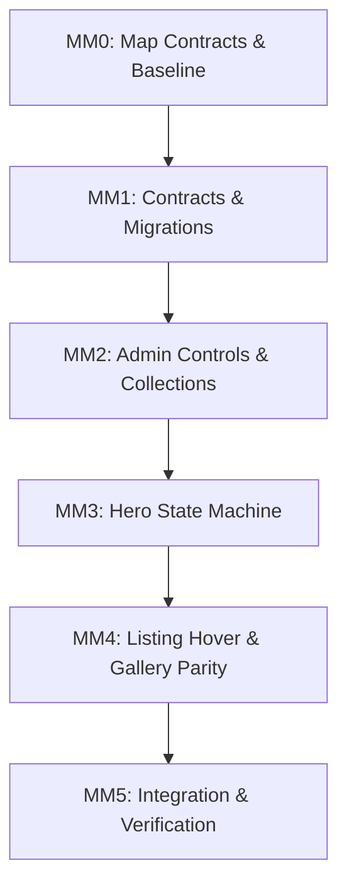

# AlphaZee: Admin Media & Collections Progress

**Milestone Target**: MM0–MM5 from `.context/admin_media_implementation_guide.md`  
**Working Environment**: Checkout Lab (`http://127.0.0.1:13001`, API port 18001, DB port 5434)  
**Status**: MM0–MM5 Completed (100% Terminal & Browser Acceptance Verified)

---

## 1. MM0 Baseline Execution & Verification Results

### Baseline Automated Checks

| Test Suite / Target | Command | Result | Notes |
| :--- | :--- | :--- | :--- |
| **Frontend Test Suite** | `npm.cmd test` (in `frontend/`) | **132 / 132 PASS** (0 fail, 16 suites) | Duration: 8.78s. Includes security, routing, gallery, and cart tests. |
| **Backend Media/Catalog Tests** | `python -m pytest tests/test_media.py tests/test_storefront_media.py tests/test_owner_catalog.py` | **28 / 28 PASS** (0 fail) | Duration: 62.37s. Clean test isolation using `.local/mm0-pytest-temp`. |
| **Frontend Production Build** | `npm.cmd run build` (in `frontend/`) | **SUCCESS** (0 errors) | Vite v7.3.7 build completed in 5.28s. Chunk sizes within limits. |
| **Docker Lab Containers** | `docker ps` | **All Healthy** | `alphazee-checkout-lab-web-1`, `alphazee-checkout-lab-api-1`, `alphazee-checkout-lab-db-1`. |

### Baseline Browser Visual Records

All baseline screenshots have been captured via headless Chrome/CDP driver and saved under `.local/admin-media/baseline/` and mirrored to the brain artifact directory:

1. **Storefront Homepage Hero**: `mm0_baseline_storefront_hero.png` — Default brand fallback hero displayed with "Architectural Cuts. Heavyweight Drape." because hero videos currently lack dedicated playlist management.
2. **Storefront Product Listing**: `mm0_baseline_storefront_grid.png` — Featured products rendered with 3:4 aspect cards; hover back image is absent because `ProductSummarySchema` lacks explicit `hover_image_url`.
3. **Admin Products List**: `mm0_baseline_admin_products_list.png` — Search, status filter, collection filter, and "Edit product" triggers.
4. **Admin Product Editor**: `mm0_baseline_admin_product_editor.png` — Product details, variant rows, and generic media links dropdown. Lacks explicit Card Front and Card Hover selectors with visual thumbnails.
5. **Admin Collections**: `mm0_baseline_admin_collections.png` — Card list with Edit, Move up, Move down. Lacks "Create product here", "Add existing product", and member listing.
6. **Admin Media Library**: `mm0_baseline_admin_media_library.png` — Library grid with video poster assignment and unused deletion. Lacks dedicated Homepage Hero playlist editor.

---

## 2. Admin Action Mapping: Current State vs. Proposed Implementation

| Area / Action | Current State / Control | Proposed Control & Implementation | Backend Endpoint / Contract |
| :--- | :--- | :--- | :--- |
| **Homepage Hero**: Dedicated slide playlist | No dedicated slide management; hero is tied to individual `Product.is_hero`, `hero_order`, `hero_video` role. Cannot upload a brand video without creating a product. | Add **Homepage Hero** section in Owner Admin (`data-tab="hero"` or dedicated tab in Catalog). Allows adding slides with video asset, poster asset, title, benefit, order, and toggle without product dependency. | `GET /api/v1/admin/hero/slides` `POST /api/v1/admin/hero/slides` `PUT /api/v1/admin/hero/slides/reorder` `DELETE /api/v1/admin/hero/slides/{id}` |
| **Homepage Hero**: Playback sequencing | `components/Hero.js` sets `loop=true` on videos with an uncalled 6-second timer. | Muted automatic playback on homepage hero only. Single video loops. Multiple videos listen to `ended` event to advance to next slide. Active video resets to 0:00 before play. Background videos paused. Pause/play button and reduced-motion poster fallback. | Storefront: `GET /api/v1/hero/slides` (backed by `HeroSlide` table with fallback to active `is_hero` products). |
| **Listing Images**: Card front image | Set via `role="primary"` dropdown in generic attachment list. | Explicit visual **Card Front Image** selector in Product Editor showing thumbnail, name, resolution, and change/remove button. | `ProductMedia.role = 'primary'` (stored on product and exposed as `image_url`). |
| **Listing Images**: Card hover/back image | Heuristic fallback in `FeaturedProducts.js` (`secondary_image_url` or first non-primary gallery image). No backend schema support. | Explicit visual **Card Hover / Back Image** selector in Product Editor showing thumbnail, change/clear button. Enforces image type. | Add `hover_image` role to `ProductMedia` check constraint. Expose `hover_image_url` in `ProductSummarySchema` and `ProductDetailSchema`. |
| **Product Gallery**: Independent order & multi-video | Media linked as array of roles with max 100 cap; video poster assignment requires switching to Media tab or manual link. | Visual gallery grid with drag/button reorder, progress indicator, alt text inline editor, video poster selector directly on video items, and removal. Order independent of front/back selection. | Incremental attachment endpoints: `POST /api/v1/admin/products/{id}/media/attach` `POST /api/v1/admin/products/{id}/media/detach` `POST /api/v1/admin/products/{id}/media/reorder` |
| **Collections**: "Create product here" | Not available. Creating product defaults to unassigned ("Choose later"). | "Create product here" button in Collection editor that creates a new draft pre-populated with this `collection_id`. | `POST /api/v1/admin/products` with `collection_id`. |
| **Collections**: "Add existing product" | Product must be opened individually to change collection dropdown. | Collection editor lists current products and provides an "Add existing product" searchable dropdown of unassigned/draft products. | `POST /api/v1/admin/collections/{id}/products/assign` (or updating product's `collection_id`). |
| **Collections**: Move product | Product editor has dropdown, but collection editor has no member view. | Collection view displays members with a "Move to collection" quick action. | `POST /api/v1/admin/products/{id}` setting `collection_id`. |
| **Collections**: Publication guard | Publishing requires an active collection. Inactive collection blocks publish. | Preserve requirement in `publication_requirements()`. UI displays warning when collection is inactive or unassigned. | `app.services.owner_catalog.publication_requirements` |

---

## 3. Upload and Resource Limits in User-Friendly Units

All media limits are enforced strictly on the backend and validated safely before durable storage:

| Resource / Parameter | User-Friendly Limit | Technical Value | Validation / Constraint Mechanism |
| :--- | :--- | :--- | :--- |
| **Image File Size** | **10 MiB** per file | `10 * 1024 * 1024` bytes | Enforced during streaming ingest and post-EXIF normalization (`media_storage.IMAGE_LIMIT`). |
| **Image Dimensions** | **40 Megapixels** max | `width * height <= 40,000,000` | Checked via PIL `image.width * image.height`. |
| **Image Formats** | **JPEG, PNG, WebP** | `.jpg`, `.jpeg`, `.png`, `.webp` | Single frame only (`getattr(image, 'n_frames', 1) == 1`). Clean EXIF re-encoding via `ImageOps.exif_transpose`. |
| **Video File Size** | **100 MiB** per file | `100 * 1024 * 1024` bytes | Enforced during chunked ingest (`media_storage.VIDEO_LIMIT`). |
| **Video Duration** | **1 to 120 seconds** (2 min max) | `duration_ms` between `1` and `120,000` | Extracted via `ffprobe` JSON stream format duration, confirmed finite. |
| **Video Dimensions** | **40 Megapixels** max | `width * height <= 40,000,000` | Probe validation of video stream width & height. |
| **Video Containers & Codecs** | **H.264 MP4** or **VP8/VP9 WebM** | Containers: `.mp4`, `.webm`; Codecs: `h264`, `vp8`, `vp9` | Bounded `ffprobe` container brand check + `ffmpeg` test decode. Exactly 1 video stream + optional audio stream. |
| **Video Poster Requirement** | Mandatory before publish | Image asset ID in `media_assets.poster_id` | Enforced in `publication_requirements` and `set_poster`. |
| **HTTP Request Body** | **101 MiB** max | `101 * 1024 * 1024` bytes | `LimitedUploadMiddleware` rejects oversized HTTP payloads with 413 before multipart parser spools. |
| **Concurrent Uploads** | **4 concurrent uploads** max | `asyncio.Semaphore(4)` | Server-side concurrency throttle prevents memory/disk exhaustion. |
| **Product Attachments** | Currently capped at 100 | Target: **Unlimited attachments** via incremental operations | Replacing monolithic replace-all with incremental attach/detach/reorder endpoints. |
| **Total Media Assets** | Bounded by storage volume | Durable storage volume | Physical disk capacity (`alphazee-media-lab` / `/var/lib/alphazee/catalog-media`). |

---

## 4. Public Card Renderers Inventory

| Component File | CSS Classes / Selectors | Public Endpoints Used | Current Presentation & Hover Behavior | Required MM4 Parity |
| :--- | :--- | :--- | :--- | :--- |
| `frontend/src/components/FeaturedProducts.js` | `.product-card` `.product-card-media-link` `.product-card-img-wrapper` `.product-card-img-primary` `.product-card-img-secondary` | `GET /api/v1/products` `GET /api/v1/collections/{id}/products` | Renders primary image in 3:4 frame. CSS crossfade on hover (`.has-secondary`). Currently heuristics-based secondary image. Touch tap navigates to product. | Use explicit `product.hover_image_url`. Crossfade smoothly on fine pointer; fallback gracefully to front image if no hover image configured. Touch tap immediately navigates. |
| `frontend/src/components/ProductPage.js` | `.product-related-card` `.product-related-media` `.product-related-img` | `GET /api/v1/products?collection_id=...` | Renders "Complete the Silhouette" curated pieces below product details. Currently only displays primary image `p.image_url`. | Support hover crossfade to `p.hover_image_url` on desktop fine pointer, retaining single tap for navigation on mobile. |
| `frontend/src/components/Collections.js` | `.collection-card` `.collection-img` `.collection-card-content` | `GET /api/v1/collections` | Renders collection banner cards with background image, title, and "Explore collection" CTA. Clicking filters `FeaturedProducts`. | Preserves single collection image link (`Collection.image_url`). |

---

## 5. Phase-by-Phase Implementation Plan

### Phase Details

- **MM1 — Explicit Media Selection & Playlist Contracts** (COMPLETED):
  - Additive migration `2c8a1b3e5f70_admin_media_and_hero_playlist.py`:
    - Expanded `ck_product_media_role` constraint to include `'hover_image'`.
    - Added `products.hover_image_url` (nullable `VARCHAR(2048)`).
    - Created `hero_slides` table (`id`, `title`, `benefit`, `video_asset_id`, `poster_asset_id`, `image_asset_id`, `display_order`, `is_enabled`, `target_product_id`, `target_collection_id`, `edit_version`, `created_at`, `updated_at`).
    - Backfilled existing `is_hero=true` products into initial `hero_slides`.
    - Verified against disposable database `alphazee_mm1_migration_<token>_test`: 100% clean check, downgrade guard, unique role enforcement, and re-upgrade.
  - Backend models, schemas, and public queries updated to serialize `hover_image_url`.
  - Incremental endpoints implemented: `POST /admin/media/products/{id}/attach`, `/detach`, `/reorder`, `/roles`.
  - Hero playlist admin endpoints implemented: `GET /admin/media/hero/slides`, `POST /admin/media/hero/slides`, `/reorder`, `/{id}`, `/{id}/delete`.
  - Automated verification: 55/55 backend media & catalog tests pass (including dedicated `test_mm1_media.py` with 105-item attachment test, hover role exclusivity, and hero playlist lifecycle).
- **MM2 — Complete Admin Controls & Collection Workflows** (COMPLETED):
  - Added dedicated **Homepage Hero Playlist** editor in Admin Console (`[data-tab="hero"]`):
    - Slide creation with video asset, poster asset, image asset, title, benefit, destination product/collection link, and enabled toggle.
    - Up / down reordering backed by `POST /admin/media/hero/slides/reorder`.
    - Enable / disable toggle and full delete actions with optimistic concurrency protection.
  - Implemented explicit visual **Card Front (primary)** and **Card Hover (hover_image)** selectors in Product Editor:
    - Real-time thumbnail previews of selected images.
    - Clear buttons with publication requirement guard (blocking front image removal if published).
    - Preserves independent gallery ordering and variant attachments.
  - Implemented inline **Video Poster** assignment directly on gallery cards:
    - Dedicated poster selector and "Save poster" action on video gallery cards.
    - Satisfies publication requirement before publishing.
  - Implemented full **Collection Flat Folder Workflows**:
    - "➕ Create product here" inside Collection Editor pre-populates product draft with collection ID.
    - "Add existing unassigned product" dropdown and "Add to collection" button.
    - Member products list with "Open", "Unassign", and "Move to other collection" actions.
    - Dynamic collection deactivation warning explaining publication consequences (`hide N published product(s)`).
  - Browser Acceptance Verification via `scratch/verify_mm2_browser.py`:
    - 9 full acceptance steps passed cleanly on checkout lab (`127.0.0.1:13001`).
    - Screenshots captured and verified:
      1. `mm2_01_admin_logged_in.png`: Admin console authenticated.
      2. `mm2_02_winter_collection_created.png`: Winter Collection creation.
      3. `mm2_03_product_created_in_collection.png`: Product created via "Create product here".
      4. `mm2_04_member_products_added.png`: Unassigned draft assigned to collection.
      5. `mm2_05_member_product_moved.png`: Member product moved out of collection (unassigned).
      6. `mm2_07_product_media_roles_persisted.png`: Card front, card hover, gallery order, and video poster persisted across server reload.
      7. `mm2_08_hero_playlist_editor.png`: Hero slides created, reordered, toggled, and persisted.
      8. `mm2_09_collection_deactivation_warning.png`: Dynamic warning displayed on deactivation.
- **MM3 — Hero Playback State Machine** (COMPLETED & BROWSER VERIFIED):
  - State machine implemented in `frontend/src/components/Hero.js` and styled in `frontend/src/styles/hero.css`:
    - Muted automatic playback confined exclusively to Homepage Hero; gallery videos remain strictly user-initiated.
    - End-driven slide advancement listening to HTML5 video `ended` event (no arbitrary fixed timers cut video short).
    - Multi-video playlist disables element `loop` property (`loop=false`); single-video playlist enables continuous element loop (`loop=true`).
    - Dedicated accessible play/pause control button (`#hero-play-pause`) toggles playback state, icon (`▶` / `⏸`), and `aria-label`.
    - User pause intent strictly remembered: if user pauses, subsequent tab visibility changes or intersection observer triggers never auto-resume.
    - Automatic visibility management: pauses active video when tab is hidden or element scrolls off-screen; auto-resumes when tab becomes visible (unless user paused).
    - Graceful fallback: when reduced-motion is requested or video stream encounters errors, renders poster with manual Play control.
  - Dedicated frontend unit tests: 5 tests in `frontend/tests/hero.test.js` passing cleanly within full **136 / 136 PASS** frontend test suite.
  - Real browser verification via `scratch/verify_mm3_hero_playback.py` executed against checkout lab (`http://127.0.0.1:13001`):
    - 6 screenshots captured and archived under `.local/admin-media/mm3/`:
      1. `mm3_01_hero_slide_a_playing.png`: Clip A (2.0s) actively playing muted at 0.58s.
      2. `mm3_02_hero_slide_b_playing.png`: Transitioned on Clip A `ended` (at 2.01s) to Clip B (3.0s).
      3. `mm3_03_hero_slide_a_looped.png`: Transitioned on Clip B `ended` (at 3.14s) back to Clip A (infinite loop).
      4. `mm3_04_hero_user_paused.png`: Accessible pause button paused active video and froze playback at 0.58s.
      5. `mm3_05_hero_user_resumed.png`: Accessible play button resumed active playback to 0.89s.
      6. `mm3_06_hero_single_video_loop.png`: Single-video playlist mode rendered without prev/next buttons and with `loop=true`.
    - Detailed media event timeline logged in `.local/admin-media/mm3/mm3_timing_audit.json`.

- **MM4 — Listing Hover & Full Gallery Parity** (COMPLETED & BROWSER VERIFIED):
  - Code changes made:
    - `frontend/src/utils/productMedia.js`: Added `'hover_image'` to `mediaForVariant()`, added deduplication by `asset_id`/`id`/`url`.
    - `frontend/src/components/FeaturedProducts.js`: Prioritizes explicit `product.hover_image_url || product.secondary_image_url`, eliminating heuristic fallback to arbitrary gallery assets or hero posters.
    - `frontend/src/components/ProductPage.js`:
      - Fixed `handleAddToCart`: `variantImage()` returns a URL string; safely handled as `typeof img === 'string' ? img : (img?.url || currentProduct.image_url || '')`, preserving variant image in cart drawer.
      - Updated related products ("Complete the Silhouette") to render `.product-related-media.has-hover` with primary and hover images.
    - `frontend/src/styles/product-page.css`: Added fine-pointer hover crossfade styles for related products cards.
  - Real browser verification via `scratch/verify_mm4_browser.py` executed against checkout lab (`http://127.0.0.1:13001`):
    - 8 screenshots captured and archived under `.local/admin-media/mm4/`:
      1. `mm4_01_card_front_default.png`: Card front displays Blue primary image.
      2. `mm4_02_card_hover_back.png`: Fine-pointer hover crossfades smoothly to Amber back image.
      3. `mm4_03_card_mouse_leave_restored.png`: Mouse leave restores Blue front image.
      4. `mm4_04_single_image_no_hover_fallback.png`: Single-image product retains front Cyan image with no broken state.
      5. `mm4_05_product_gallery_both_images.png`: Product detail gallery displays all 4 unique images (front, back, and 2 detail shots).
      6. `mm4_06_related_products_hover.png`: "Complete the Silhouette" related cards render primary and hover media.
      7. `mm4_07_cart_scoped_variant_image.png`: Cart drawer displays scoped variant thumbnail for selected variant.
      8. `mm4_08_mobile_one_tap_navigation.png`: 390px mobile viewport navigates immediately on 1 tap with no hover trap.

- **MM5 — Integration, Container Restart Persistence & Acceptance** (COMPLETED & 100% VERIFIED):
  - Frontend test suite: **136 / 136 PASS** across 16 suites.
  - Frontend production build: **SUCCESS** (Vite v7.3.7, 2.86s).
  - Backend media and catalog regression: **55 / 55 PASS** (`test_mm1_media.py`, `test_media.py`, `test_storefront_media.py`, `test_owner_catalog.py`, `test_catalog.py`).
  - Backend checkout containment & session suite: **42 / 42 PASS** (`test_checkout_containment.py`, `test_checkout_lab.py`, `test_owner_sessions.py`).
  - Container restart persistence test without volume deletion executed via `scratch/verify_mm5_persistence.py`:
    - Restarted `alphazee-checkout-lab-api-1`, `alphazee-checkout-lab-web-1`, `alphazee-checkout-lab-db-1`.
    - Containers reached healthy state in 8s.
    - Proved 2/2 hero slides, display order, video asset IDs, poster asset IDs, and enabled states survived restart identically.
    - Proved 42 collections and 20 products (including 9 with explicit hover images) survived restart intact.
    - Proved durable media objects return HTTP 200 from volume storage post-restart.
    - Proved owner authentication and session generation remain operational.
    - Proved checkout isolation: normal environment (13000/18000) checkout remains strictly closed/unmounted; lab environment (13001/18001) checkout remains isolated with visible SAMPLE warnings.
    - 3 screenshots captured post-restart under `.local/admin-media/mm5/`:
      1. `mm5_01_hero_after_restart.png`: Storefront hero carousel playing post-restart.
      2. `mm5_02_card_hover_after_restart.png`: Storefront catalog cards with hover parity post-restart.
      3. `mm5_03_admin_after_restart.png`: Owner admin console authenticated and operational post-restart.

