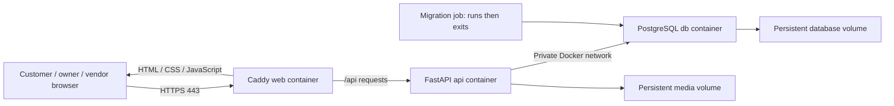

# AlphaZee: understand your system before configuring Azure

**Checkout update:** production release code is now implemented. Follow `.context/production_checkout_release.md` for `PRODUCTION_CHECKOUT_ENABLED=true/false`. Section 9's description of the missing switch records the earlier state; deployment/business acceptance still remains necessary.

Prepared 2026-11-06 from the actual repository and current Microsoft documentation. You confirmed **Azure for Students with approximately $100 credit**. Remaining balance, expiry, eligible free services, region quotas and domain ownership are still unknown. No Azure resources were created and no cloud deployment was verified.

## 1. The decision to make first

Use the student account for learning and staging. Microsoft's education FAQ describes its supported purposes as education, noncommercial research and associated development/testing. Confirm an appropriate subscription for the commercial shop with Azure support before real sales; do not assume that student credit funds a commercial launch. The $100 is a credit pool for the offer period, not $100 every month. [Microsoft education FAQ](https://learn.microsoft.com/en-us/azure/education-hub/faq#can-i-use-azure-for-students-for-production-or-only-for-development)

**Recommended first architecture: one Linux Azure VM running your existing production Docker Compose stack.** This is a recommendation based on compatibility and operational simplicity, not proof it is the cheapest Azure configuration in your subscription. Price it before creating it. Start as staging with checkout closed; commercial launch is a separate milestone.

## 2. What you already built

AlphaZee has three interfaces: customer storefront `/`, owner portal `/admin`, and stock-only vendor portal `/vendor`. They are routes in **one frontend application**, sharing **one backend API** and **one PostgreSQL database**. They do not need three servers or three hosting plans.

| Component | Actual technology and responsibility | Production behavior |
| --- | --- | --- |
| Frontend | Vite builds JavaScript, HTML and CSS; currently no React/Next.js server | Static files served by Caddy; most UI code executes in visitors' browsers |
| Backend | Python 3.13, FastAPI, Uvicorn, SQLAlchemy | Handles login, catalog, stock, orders, supplier finance, settings and media |
| Database | PostgreSQL 16 | Stores products, users, password hashes, orders, inventory and financial records |
| Media | Files plus database metadata | Images/videos are in a separate persistent filesystem volume, not PostgreSQL blobs |
| Migrations | Alembic | Updates database structure before the application starts |

Docker terminology: an **image** is the packaged software; a **container** is its running instance; a **volume** stores persistent data; **Compose** coordinates the containers. The **VM** is the rented Linux computer hosting Docker. Azure bills the VM/resources, not a fixed hosting fee for each Compose container.

## 3. How many containers?

`compose.prod.yml` defines **four services: three stay running, one exits successfully**.

| Service | Runs continuously? | Job | Ports |
| --- | --- | --- | --- |
| `web` | Yes | Caddy serves built frontend, handles HTTPS, forwards `/api/*` | Public TCP 80/443; optional UDP 443 |
| `api` | Yes | Runs the FastAPI backend | 8000 inside Docker only |
| `db` | Yes | Runs PostgreSQL | 5432 inside Docker only |
| `migrate` | No | Checks production configuration, then runs `alembic upgrade head` | No public port; exit 0 is success |

API and migration use the same application image. Node 22 builds frontend assets but does not need a separate production Node server. Startup order is database healthy → migration succeeds → API ready → web starts.



Example: opening a product downloads frontend code, then that code requests `/api/v1/products/<slug>`. Caddy forwards the request to `api:8000`. The API reads PostgreSQL and returns product data. Media URLs reach the API, which serves the files. Only the API talks to PostgreSQL; visitors never need its password or network access.

## 4. Is the database hosted with the backend?

**On the same VM, yes; inside the same container, no.** They are separate processes with separate persistent storage, connected through Docker's private network. The database hostname `db` works inside that network. `localhost` inside the API container means the API container itself, not PostgreSQL.

The production file declares four volumes:

- `pgdata`: PostgreSQL data, including persistent owner/vendor accounts.
- `catalog_media`: uploaded files at `/var/lib/alphazee/catalog-media` in the API.
- `caddy_data`: certificate/account state for HTTPS.
- `caddy_config`: Caddy configuration state.

Docker volumes normally live on the VM disk. Use persistent managed storage, never an ephemeral OS disk or temporary scratch disk for this data. An ordinary container replacement retains its named volumes. Deleting volumes, disks, the wrong resource group, or running `docker compose down -v` can destroy data. Persistent storage is **not a backup**. [Azure disk types](https://learn.microsoft.com/en-us/azure/virtual-machines/disks-types)

Copying code to Azure does not copy your database, accounts or uploaded photos. A fresh deployment starts empty after migrations. Provision a strong production owner and populate approved catalog content. Do not restore the whole development/lab database: it contains test history and temporary personal media. Existing catalog-transfer tooling is guarded for lab import, not an approved production import pipeline.

## 5. Can it stay online 24/7?

Yes, while the Azure VM is running, funded and reachable, Docker starts on boot, and the containers remain healthy. Your laptop and SSH terminal can be turned off. Existing `restart: unless-stopped` policies restart exited containers, but do not automatically repair every unhealthy application or failed migration.

A single VM is a budget starting point with a single point of failure. Maintenance, exhausted credits, disk exhaustion and faults can interrupt service. It is not a guarantee of uninterrupted availability. Add uptime checks, disk/CPU/RAM monitoring, bounded logs, backups and a tested recovery process before real orders.

For learning, deallocate the VM between sessions; your site then goes offline. Azure distinguishes **Stopped (allocated)**, which can still incur compute charges, from **Stopped (deallocated)**. Disks and other retained resources may still cost money. Do not use nightly shutdown for a shop promised to be always available. [VM billing states](https://learn.microsoft.com/en-us/azure/virtual-machines/states-billing)

## 6. Spend the credit deliberately

Calculate the full cost:

`monthly total = VM hourly rate × running hours + disk + public IP + backups + bandwidth + selected monitoring/other services`

For continuous operation, budget approximately 730 hours/month. **Illustration only, not Azure price quotes:**

| Hypothetical VM rate | Compute alone at 730 hours |
| --- | --- |
| $0.01/hour | $7.30/month |
| $0.02/hour | $14.60/month |
| $0.04/hour | $29.20/month |

If the actual total becomes $25/month, $100 lasts about four months; at $40/month it lasts about 2.5 months, before credit expiry. To stretch $100 across 12 months, average total charge must stay below about $8.33/month. Free allowances might help, but verify the exact eligible SKU, hours, disk allowance and remaining entitlement in your own account. Never infer that “free VM” means free disk, IP, backup and traffic.

Use the [Azure pricing calculator](https://azure.microsoft.com/en-us/pricing/calculator/) with your region, Linux SKU, currency and actual runtime. Record both gross resource cost and confirmed allowance-adjusted cost. Do not select a bigger available machine just because the cheap SKU is unavailable; compare allowed regions/quotas first.

Set a small monthly budget and alerts at 50%, 80% and 100%, plus a forecast alert if supported. **Budget alerts do not cap spending or stop resources**, and cost data/alerts can lag. Keep the student spending limit unless you intentionally choose a paid upgrade after understanding it. Review actual daily cost after provisioning. [Budget behavior](https://learn.microsoft.com/en-us/azure/cost-management-billing/costs/tutorial-acm-create-budgets), [spending limits](https://learn.microsoft.com/en-us/azure/cost-management-billing/manage/spending-limit)

Videos affect both disk and outgoing traffic. A 20MB video downloaded 1,000 times is roughly 20GB of payload, before other media. Keep backups and monitoring retention bounded; stop unused staging resources and inspect retained disks/IPs separately.

## 7. Suggested configuration to price first

These are starting choices, not a completed capacity test or fixed SKU order.

| Azure choice | Starting direction |
| --- | --- |
| Resource group | One clearly named group, e.g. `rg-alphazee-staging`; tags for project/environment |
| VM OS | Ubuntu Server 24.04 LTS, x86-64, regular Linux VM; validate image availability |
| Size | Compare approximately 2 vCPU / 4 GiB burstable choices, e.g. B2s if available, against your actual budget |
| Smaller alternative | 2 GiB for measured light staging may work; 1 GiB is not a safe assumed capacity for PostgreSQL + Python + media decoding/builds |
| Purchase model | Pay-as-you-go compute using eligible credit; no Spot eviction risk, reservation or savings-plan commitment for the first setup |
| Region | Available to your subscription, reasonably close to intended Pakistani users, affordable; test latency rather than guessing |
| Disk | Persistent managed Standard SSD; estimate OS/images/media/backups before choosing size, e.g. compare 64 GiB total capacity |
| Public access | Standard static public IPv4; compare its separate price |
| Firewall/NSG | TCP 80/443 for visitors; SSH 22 only from your current IP. Do not expose 5432, 8000, 3000 or local lab ports |
| Login | SSH key; keep the private key private |
| DNS | Your domain/subdomain pointing to the public IP; for learning, check whether the public IP's Azure DNS label/FQDN is available |

A persistent OS disk can initially hold Docker volumes; a separate data disk adds cost and requires deliberate Docker storage/mount configuration. Never assume attaching a disk automatically moves Docker data onto it. Check free space and Docker's actual storage location. Burstable CPU is suitable only if measured usage fits; sustained video validation may exhaust CPU credits. [B-series behavior](https://learn.microsoft.com/en-us/azure/virtual-machines/sizes/general-purpose/bsv2-series)

Avoid optional paid services unless you understand their role and incremental cost: AKS, Application Gateway, NAT Gateway, paid Bastion, ACR, premium disks and extensive log ingestion. A VM/VNet/NIC/NSG are expected; Microsoft-managed PostgreSQL, Azure Files and a registry are not prerequisites for this Compose design.

## 8. Why not split everything across Azure services immediately?

| Option | Fit for this repository |
| --- | --- |
| One VM + Compose | Closest to current files; one host to understand; you maintain OS, database and backups |
| Static frontend + managed API + managed PostgreSQL | More independent scaling/operations, but needs routing/auth/deployment changes, separate storage and a new cost estimate |
| Container Apps | Can scale idle services down, but is not a drop-in home for this stateful Compose stack; cold starts, database, media persistence and networking require design work |

Container Apps' scale-to-zero can reduce compute charges, while other resources still contribute cost. Its container-local storage is ephemeral; durable media needs supported persistent storage or an application storage integration. Your production preflight currently **requires PostgreSQL at `db:5432`**, so managed PostgreSQL requires a reviewed code/configuration change. Azure SQL is not a substitute for PostgreSQL here. [Container Apps billing](https://learn.microsoft.com/en-us/azure/container-apps/billing), [storage](https://learn.microsoft.com/en-us/azure/container-apps/storage-mounts)

## 9. Hosting and opening orders are separate steps

The repository supports production checkout through **`PRODUCTION_CHECKOUT_ENABLED`** in `.env.production`. It defaults false, returning 503 for new checkout attempts. Set true and recreate production containers to enable orders after store setup. Capabilities then report checkout enabled and test mode false. The isolated test gate remains separate; production still requires production mode and test checkout disabled.

The release mechanism and off switch are now implemented and terminal-tested; follow `.context/production_checkout_release.md`. Do not rename production as a test database or set `APP_ENV=test` to bypass isolation. Bank transfers additionally need real validated account configuration; COD and bank reconciliation are manual business operations. Card gateways are optional for this model.

Also finish real products/media/stock, shipping rules, vendor agreements, policies/support, production owner credentials, proxy-aware throttling review, matched backups and restore rehearsal. Recheck actual browser acceptance in Azure; local reports do not certify cloud behavior.

## 10. Setup sequence with your AI helper

1. Verify subscription/remaining credit/expiry/free allowances; agree staging versus commercial objective and full monthly budget.
2. Estimate the exact resource basket; then create VM/network/storage. Save selected region/SKU/IP/resource names, without secrets.
3. SSH into the VM, install Docker Engine and Compose from [Docker's Ubuntu instructions](https://docs.docker.com/engine/install/ubuntu/), enable Docker on boot and verify disk placement. Keep Azure NSG rules restrictive; published Docker ports can bypass some host-firewall rules.
4. Transfer a reviewed source revision, excluding private `.env` files, `.local`, browser profiles, dumps and temporary photos. Keep a record of the deployed commit/image tag.
5. Point a real DNS name at the public IP. Set `.env.production` from `.env.production.example` privately on the host, with restrictive permissions. `SITE_DOMAIN` is a hostname, without `https://` or a path. Use a unique random database password of at least 20 characters and a matching, URL-safe/encoded database URL. Leave bank details blank until approved. Caddy obtains/renews certificates when public DNS, reachable ports and persistent writable certificate storage are correctly configured. [Caddy HTTPS requirements](https://caddyserver.com/docs/automatic-https)
6. Run the production preflight/migrations and containers. The following are the existing **Linux VM** commands, not instructions to run against local development:

```sh
docker compose --env-file .env.production -f compose.prod.yml config --quiet
docker compose --env-file .env.production -f compose.prod.yml up --build --wait -d
docker compose --env-file .env.production -f compose.prod.yml ps -a
docker compose --env-file .env.production -f compose.prod.yml exec api python scripts/provision_owner.py YOUR_OWNER_USERNAME
```

The last command is interactive; choose a strong password, never the development short-password option. Never paste filled environment files/passwords into AI chats. `migrate` exiting 0 is expected. A changed `POSTGRES_PASSWORD` environment value does not rotate an already initialized database user's password.

7. Verify HTTPS/home/admin/vendor/product deep links, `/api/v1/ready`, `/api/v1/storefront/capabilities`, uploads/video ranges and persistence after reboot. Expect checkout closed at this stage. Confirm 8000/5432 are not public.
8. Set bounded container logs, uptime/resource alerts, and matched off-host database/media backups. Stop all writers for a consistent pair; test restoration into separate empty storage. Follow `.context/m3_media_runbook.md`, not ad-hoc binary dump redirection in Windows PowerShell.
9. Measure staging CPU/RAM/disk/latency and actual cost for several days. Resolve gaps, choose the commercial subscription, and complete production browser acceptance before enabling real customer orders/ads.

You are responsible for OS/Docker/PostgreSQL updates on this VM design. Image rollback does not automatically undo a database migration. Keep a known-good version and backup before upgrades.

## 11. What to send the next AI

Send `.context/azure_ai_setup_context.md` first. Give one redacted screenshot at a time. Include which machine/shell you are using and the exact non-secret error. The helper cannot read this repository unless you attach relevant files. Start with the Subscription overview and remaining-credit/free-services view, **before clicking Create on a VM**.
