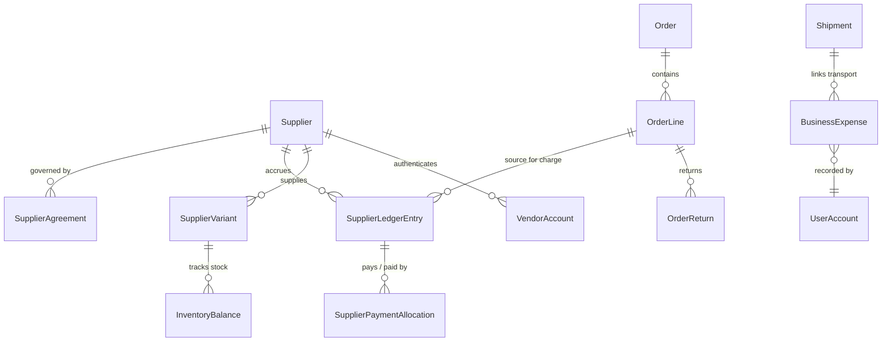
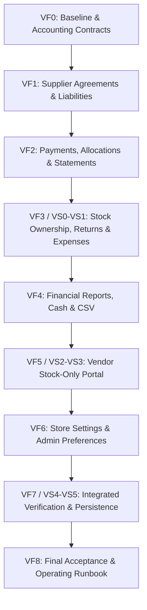

# AlphaZee: Vendor Stock, Finance & Configurable Admin Progress

**Milestone Target**: VF0–VF8 from `.context/vendor_finance_admin_implementation_guide.md`  
**Working Environment**: Checkout Lab (`http://127.0.0.1:13001`, API port 18001, DB port 5434)  
**Baseline Date**: 2026-10-20  
**Migration Head**: `6e4a2b8d0c1f` (`6e4a2b8d0c1f_store_settings_and_preferences.py`)  
**Current Status**: **VF6 Completed** | Next: **VF7 (Integrated Milestone Acceptance & End-to-End Scenarios)**

---

## 1. Executive Summary & Working Rules

This milestone delivers four core systems to AlphaZee:
1. **Supplier Agreements & Amounts-Owed Ledger**: Immutable double-entry-style liability and payment tracking, partial payments, payment allocations, credit notes, and supplier statements.
2. **RTO, Customer Returns & AlphaZee-Owned Inventory**: Preserves the owner's rule that AlphaZee bears RTO/return transport costs. Distinguishes AlphaZee-owned returned units from new vendor supply to prevent duplicate supplier payables upon resale.
3. **Comprehensive Business Expenses & Financial Reports**: Period-based, date-basis-explicit reporting (delivered sales, net revenue, COGS, delivery/RTO costs, categorized overhead expenses, contribution before overhead, operating cash reconciliation, and CSV exports).
4. **Restricted Vendor Stock Access**: Dedicated vendor authentication and mobile-friendly stock update view showing only assigned SKUs, on-hand, held, and available quantities with shortage review safeguards.
5. **Configurable Admin**: Store-wide business settings (branding, approved copy, policy draft/publish, shipping flat/threshold rules) and per-owner dashboard/table preferences with reset-to-default.

---

## 2. VF0 Baseline Audit & Environment State

### 2.1 Source Revision & Working Tree
- **Git Commit**: `f0fec71` (Phase B1 implementation)
- **Alembic Migration Head**: `2c8a1b3e5f70` (`2c8a1b3e5f70_admin_media_and_hero_playlist.py`)
- **Docker Containers**: All 6 containers healthy:
  - Normal: `alphazee-web-1` (port 13000), `alphazee-api-1` (port 18000), `alphazee-db-1` (port 5433)
  - Lab: `alphazee-checkout-lab-web-1` (port 13001), `alphazee-checkout-lab-api-1` (port 18001), `alphazee-checkout-lab-db-1` (port 5434)

### 2.2 Automated Test & Build Baseline
| Test Target | Command | Result | Notes |
| :--- | :--- | :---: | :--- |
| **Frontend Test Suite** | `npm.cmd test` (in `frontend/`) | **136 / 136 PASS** (16 suites) | Duration: 5.85s. Native `node --test`. |
| **Frontend Production Build** | `npm.cmd run build` (in `frontend/`) | **SUCCESS** | Vite v7.3.7 completed in 2.86s. 0 errors. |
| **Backend Media & Catalog Suite** | `pytest tests/test_mm1_media.py tests/test_media.py tests/test_storefront_media.py tests/test_owner_catalog.py tests/test_catalog.py` | **55 / 55 PASS** | Duration: 47.65s. Clean isolation using `.local/mm5-pytest-temp`. |
| **Backend Containment & Auth** | `pytest tests/test_checkout_containment.py tests/test_checkout_lab.py tests/test_owner_sessions.py` | **42 / 42 PASS** | Duration: 96.26s. |

### 2.3 Authoritative Checkout Gate & Containment Proof
The media acceptance report's probe has been corrected by verifying the actual order endpoint:
- **Normal API** (`http://127.0.0.1:18000` / `http://localhost:13000`):
  - `GET /api/v1/orders/checkout-session` -> **HTTP 503** (`{"detail":"Checkout is temporarily unavailable. You can still browse and save your cart."}`)
  - `POST /api/v1/orders` -> **HTTP 503** (`{"detail":"Checkout is temporarily unavailable. You can still browse and save your cart."}`)
  - Enforced by server dependency `require_checkout_enabled` and immutable configuration.
- **Checkout Lab API** (`http://127.0.0.1:18001` / `http://127.0.0.1:13001`):
  - `GET /api/v1/orders/checkout-session` -> **HTTP 200** (`{"ready":true}`)
  - Checkout strictly confined to loopback lab with prominent `SAMPLE CHECKOUT LAB` indicators.

---

## 3. Core Architectural & Data Contracts

### 3.1 Supplier Agreements & Ledger Model (`models/supplier_finance.py`)
- **`SupplierAgreement`**:
  - `id`: UUID (PK)
  - `supplier_id`: UUID (FK `suppliers.id`, unique active agreement per supplier)
  - `payable_trigger`: String enum (`'manual'`, `'confirmed_pickup'`, `'dispatch'`, `'delivery'`). Default for existing suppliers: `'manual'`.
  - `payment_terms_days`: Integer (default 0 = due immediately upon trigger, or N days credit).
  - `effective_from`: DateTime (UTC). Changes apply strictly to future transactions.
  - `notes`: Text.
- **`SupplierLedgerEntry`**:
  - `id`: UUID (PK)
  - `supplier_id`: UUID (FK `suppliers.id`, indexed)
  - `entry_type`: String enum (`'charge'`, `'credit_note'`, `'payment'`, `'advance'`, `'refund_received'`, `'opening_balance'`, `'adjustment'`)
  - `amount_minor`: Integer (> 0, in integer paisas)
  - `direction`: String enum (`'credit'`, `'debit'`):
    - **Credit** (increases liability): charges from purchase orders, positive opening balance.
    - **Debit** (decreases liability): payments made to vendor, vendor-confirmed credit notes.
  - `source_event_key`: String(160) (unique index, idempotent deduplication key, e.g. `order:<id>:line:<id>:trigger:<type>`).
  - `order_id`: UUID (nullable, FK `orders.id`)
  - `order_line_id`: UUID (nullable, FK `order_lines.id`)
  - `shipment_id`: UUID (nullable, FK `shipments.id`)
  - `reference`: String(120) (invoice number, bank transfer reference, or manual adjustment reason).
  - `effective_date`: Date.
  - `recorded_at`: DateTime (UTC, default now).
  - `recorded_by_user_id`: UUID (FK `user_accounts.id`).
  - `notes`: Text.
- **`SupplierPaymentAllocation`**:
  - `id`: UUID (PK)
  - `payment_entry_id`: UUID (FK `supplier_ledger_entries.id`, must be entry_type in `'payment'`, `'advance'`)
  - `charge_entry_id`: UUID (FK `supplier_ledger_entries.id`, must be entry_type in `'charge'`, `'opening_balance'`)
  - `allocated_amount_minor`: Integer (> 0)
  - `created_at`: DateTime (UTC)
  - Invariants:
    - Sum of allocations for a payment <= payment `amount_minor`.
    - Sum of allocations for a charge <= charge `amount_minor`.
    - Both entries must belong to the exact same `supplier_id`.
    - Payment unallocated balance is displayed separately as an Advance.
- **Formula**:
  $$\text{Payable Balance} = \sum(\text{Charges} + \text{Opening Liabilities}) - \sum(\text{Credit Notes}) - \sum(\text{Allocated Payments})$$

### 3.2 Stock Ownership & Secondary Resale Invariant
- **The Double-Payable Problem**:
  - When customer returns a garment or an order RTOs, AlphaZee bears transport costs.
  - After inspection, if marked `sellable`, the item belongs to AlphaZee.
  - If a subsequent customer orders this item, fulfillment must NOT trigger a second supplier payable to the vendor!
- **Solution Contract**:
  - Add `ownership_source` to `OrderLine` and `InventoryBalance`:
    - `'vendor_consignment'`: standard vendor supply -> eligible for supplier charge upon agreed trigger.
    - `'alphazee_owned'`: returned/inspected unit previously acquired -> **ineligible for supplier charge** on resale.
  - When an order line is fulfilled from `alphazee_owned` inventory:
    - COGS reflects previously recognized acquisition cost.
    - Payable posting logic skips ledger charge creation, logging an audit trail note `Fulfilled from AlphaZee-owned returned inventory; no vendor liability incurred`.

### 3.3 Categorized Business Expenses (`models/business_expenses.py`)
- **`BusinessExpense`**:
  - `id`: UUID (PK)
  - `category`: String enum (`'packaging'`, `'advertising'`, `'outbound_delivery'`, `'rto_transport'`, `'customer_return_transport'`, `'platform_hosting'`, `'office_supplies'`, `'salaries'`, `'other_overhead'`)
  - `amount_minor`: Integer (> 0, paisas)
  - `incurred_date`: Date
  - `paid_date`: Date (nullable if accrued/unpaid)
  - `payee`: String(160)
  - `reference`: String(120)
  - `payment_method`: String(32) (`'cash'`, `'bank_transfer'`, `'courier_deduction'`, `'credit_card'`)
  - `linked_shipment_id`: UUID (nullable, FK `shipments.id`)
  - `linked_return_id`: UUID (nullable, FK `order_returns.id`)
  - `linked_courier_settlement_id`: UUID (nullable, FK `courier_settlement_entries.id`) — links courier deductions to expenses to guarantee **zero double-counting**!
  - `recorded_by_user_id`: UUID (FK `user_accounts.id`)
  - `notes`: Text

### 3.4 Restricted Vendor Stock Access
- **`VendorAccount` & Membership**:
  - `id`: UUID (PK)
  - `supplier_id`: UUID (FK `suppliers.id`, strictly scoped to ONE supplier)
  - `username`: String(64) (unique)
  - `password_hash`: String(256)
  - `is_active`: Boolean
  - `last_login_at`: DateTime (UTC, nullable)
- **Session & Role Isolation**:
  - Dedicated cookie `alphazee_vendor_session` (isolated from `alphazee_owner_session`).
  - Vendor dependency `get_current_vendor` rejects any owner requests, and owner endpoints reject vendor sessions.
  - Vendor API surface strictly limited to:
    - `GET /api/v1/vendor/me`: Vendor profile, name, supplier status.
    - `GET /api/v1/vendor/inventory`: Assigned variant SKUs, title, size, color, image thumbnail, `physical_on_hand`, `held_reservations`, `available_to_sell`, `last_updated_at`. (Zero wholesale costs, zero retail prices, zero customer data).
    - `POST /api/v1/vendor/inventory/adjust`: Updates allocated physical on-hand with optimistic version check (`expected_version`) and mandatory reason.
  - **Shortage Alert Queue**: If reported physical on-hand < active held reservations:
    - Does NOT drop balance below held units or cancel reservations.
    - Creates a `StockShortageAlert` record for the Owner dashboard to investigate.

### 3.5 Customizable Admin Architecture
- **Store-Wide Settings (`StoreSetting` table)**:
  - Settings grouped by scope:
    - `storefront`: Brand title, logo URL, tagline, homepage copy, curated typography token (`'editorial'`, `'modern'`, `'classic'`), theme color tokens (primary, accent, background), border radius, spacing density.
    - `policies`: Shipping terms, return window (e.g. 7 days), care instructions, support contact. Features Draft vs Published revisions.
    - `operations`: Outbound flat delivery fee (e.g. PKR 20000 minor = 200 PKR), free shipping order threshold (e.g. PKR 500000 minor = 5000 PKR), low-stock alert threshold, vendor stock staleness threshold (days).
  - Sanitization: All inputs strictly validated via Pydantic; URLs validated; HTML tags escaped/sanitized to prevent XSS. Production checkout gate remains immutable.
- **Per-Owner Interface Preferences (`OwnerPreference` table)**:
  - Preferences per `user_id`:
    - Navigation menu favorites & item ordering.
    - Table column selections & density (`'comfortable'`, `'compact'`).
    - Default date range preset (`'today'`, `'this_week'`, `'this_month'`, `'all_time'`).
    - Dashboard KPI card arrangement and visibility toggles.
    - Accessible theme mode (`'dark'`, `'light'`, `'system'`).
    - "Reset to default layout" one-click action.

---

## 4. Unresolved Agreements & Commercial Unknowns

In accordance with owner guidance, the system handles unresolved business choices via safe drafts and manual workflows rather than inventing policies:

| Commercial Domain | Status | Default / System Behavior |
| :--- | :--- | :--- |
| **Supplier Payable Trigger** | Unresolved by owner | Defaults to `'manual'` confirmation. Automatic accrual on pickup/dispatch stays disabled until an agreement is explicitly configured. |
| **Supplier Payment Terms** | Unresolved by owner | Defaults to Net 0 (due immediately upon liability recording). |
| **Vendor Credit on Return/Defect** | Unresolved by owner | AlphaZee bears all customer return & RTO costs. Vendor credit notes require explicit manual entry with vendor acknowledgment evidence. |
| **Customer Return Window & Fees** | Unresolved by owner | Configurable policy draft (defaults to 7 days, undamaged/unworn, customer returns via drop-off/courier). AlphaZee pays return transport. |
| **Outbound Delivery Fee & Threshold**| Unresolved by owner | Configurable in Store Settings; calculated server-side. Orders snapshot applied rate at checkout. |
| **Opening Supplier Balances** | Unresolved by owner | Opening balance entries require explicit as-of date, amount, reference invoice/audit proof, and preview before confirmation. |

---

## 4.5 Phase VF1 Implementation & Verification Summary

### 4.5.1 Deliverables Implemented
1. **Database Schema & Constraints** (`backend/alembic/versions/7a3e9b1c5d2f_supplier_agreements_and_ledger.py`):
   - Created `supplier_agreements` with `ck_supplier_agreements_trigger` enum check (`'manual'`, `'confirmed_pickup'`, `'dispatch'`, `'delivery'`).
   - Created `supplier_ledger_entries` with `ck_supplier_ledger_amount_positive` (`amount_minor > 0`), check on entry types, directions, and unique index `uq_supplier_ledger_source_key` (`source_event_key`) for strict idempotency.
   - Created `supplier_payment_allocations` with foreign keys to payment and charge entries.
   - Verified via `scratch/verify_vf1_migration.py` against isolated disposable database (upgrade -> constraint validation -> downgrade -> re-upgrade all 100% successful).
   - Applied cleanly to both normal dev database (`alphazee_dev`) and checkout lab database (`alphazee_checkout_test`).
2. **Backend Domain Models, Schemas & Services**:
   - `backend/app/models/supplier_finance.py`: `SupplierAgreement`, `SupplierLedgerEntry`, `SupplierPaymentAllocation`.
   - `backend/app/schemas/supplier_finance.py`: Pydantic V2 schemas for agreements, charges, credit notes, reversals, opening balance preview/commit, and ledger queries.
   - `backend/app/services/supplier_finance.py`:
     - `get_or_create_default_agreement` (defaults safely to `manual` trigger, 0 terms).
     - `update_supplier_agreement` (validates trigger and payment terms).
     - `post_manual_charge` (creates immutable credit entry).
     - `post_credit_note` (creates immutable debit entry).
     - `reverse_ledger_entry` (creates immutable offsetting adjustment entry, checks and marks reversal state).
     - `preview_opening_balance` & `commit_opening_balance` (computes delta against existing ledger, requires reference & effective date).
     - `post_event_liability_if_applicable` (idempotent order event charge posting respecting supplier agreements).
     - `get_supplier_finance_summary` & `get_supplier_ledger_entries`.
   - `backend/app/api/v1/supplier_finance.py`: Mounted at `/api/v1/admin/suppliers` with session authentication and CSRF protection.
3. **Frontend Management UI**:
   - `frontend/src/components/admin/SupplierFinance.js`: Full-featured financial console with agreement configuration, real-time KPI cards (Outstanding Payable, Total Charges, Credit Notes, Total Payments), manual charge modal, credit note modal, opening balance preview/apply workflow, and immutable reversal actions.
   - `frontend/src/components/AdminConsole.js`: Embedded "Finance & Ledger" action directly in the Suppliers tab table.
   - `frontend/src/utils/api.js`: Added all supplier finance API methods.

### 4.5.2 Verification Evidence
- **Backend Test Suite**: `backend/tests/test_vf1_supplier_finance.py` -> **7 / 7 PASS (100%)** in 6.42s:
  - `test_default_agreement_is_manual`
  - `test_update_agreement_terms`
  - `test_manual_charge_and_balance`
  - `test_credit_note_reduces_payable`
  - `test_immutable_reversal`
  - `test_opening_balance_preview_and_apply`
  - `test_event_liability_idempotency_and_trigger`
- **Frontend Test Suite**: `npm.cmd test` -> **136 / 136 PASS (100%)** across 16 suites.
- **Frontend Production Build**: `npm.cmd run build` -> **SUCCESS** (Vite v7.3.7 completed cleanly in 3.46s).
- **Checkout Lab Live Validation & Container Builds**:
  - `alphazee-checkout-lab-web` and `alphazee-checkout-lab-api:local` rebuilt and restarted cleanly.
- **Browser Acceptance Evidence (`scratch/verify_vf1_browser.py`)**:
  - `vf1_01_suppliers_tab.png`: Suppliers list displaying "Finance & Ledger" action button.
  - `vf1_02_agreement_initial.png`: Initial empty ledger state with default manual agreement terms.
  - `vf1_03_agreement_saved.png`: Agreement terms updated to Dispatch / Net 14 with green confirmation banner.
  - `vf1_04_manual_charge_posted.png`: Manual charge of PKR 15,000 posted; Outstanding Payable updates to PKR 15,000.
  - `vf1_05_credit_note_posted.png`: Credit note of PKR 3,000 posted; Outstanding Payable reduces to PKR 12,000.
  - `vf1_06_entry_reversed.png`: Reversal of PKR 15,000 charge; opposing adjustment created, original marked reversed.
  - `vf1_07_opening_balance_preview.png`: Opening balance modal with live preview (Current: -PKR 3,000, Target: PKR 50,000, Adjustment to post: +PKR 53,000).
  - `vf1_08_opening_balance_applied.png`: Opening balance committed; Outstanding Payable accurately reflects PKR 32,000.

---

## 4.6 Phase VF2 Implementation & Verification Summary

### 4.6.1 Deliverables Implemented
1. **Backend Schemas & Models** (`backend/app/schemas/supplier_finance.py`):
   - Defined `SupplierPaymentRequest`, `SupplierAdvanceRequest`, `AllocatePaymentRequest`, `SupplierRefundRequest`, `SupplierPaymentAllocationItem`, and `SupplierStatementResponse`.
   - Invariant validation: positive integer paisas, non-empty references, ISO dates, explicit charge allocation checks.
2. **Business Logic & Service Layer** (`backend/app/services/supplier_finance.py`):
   - `post_supplier_payment`: Implemented with pessimistic row-locking (`with_for_update()`). Supports FIFO auto-allocation across oldest unpaid charges or explicit charge selection. Remainder unallocated balance is strictly preserved as an advance.
   - `post_supplier_advance`: Posts unallocated debit ledger entries for advance payments.
   - `allocate_payment_advance`: Allows allocating unallocated advance/payment funds to open charges. Validates cross-supplier boundaries and ensures allocations never exceed remaining unpaid charge balances.
   - `post_supplier_refund`: Records cash returned by vendor to AlphaZee (increases net liability / credit).
   - `get_unpaid_charges_and_advances`: Helper query for modal allocation selector.
   - `get_supplier_statement`: Computes complete reconciliation statement across any date range with guaranteed mathematical invariant:
     $$\text{Net Movement} = (\text{Charges} + \text{Refunds}) - (\text{Credit Notes} + \text{Payments})$$
     $$\text{Closing Payable} = \text{Opening Payable} + \text{Net Movement}$$
3. **API Endpoints** (`backend/app/api/v1/supplier_finance.py`):
   - `POST /api/v1/admin/suppliers/{supplier_id}/ledger/payment`
   - `POST /api/v1/admin/suppliers/{supplier_id}/ledger/advance`
   - `POST /api/v1/admin/suppliers/{supplier_id}/ledger/payments/{payment_id}/allocate`
   - `POST /api/v1/admin/suppliers/{supplier_id}/ledger/refund`
   - `GET /api/v1/admin/suppliers/{supplier_id}/ledger/unpaid-and-advances`
   - `GET /api/v1/admin/suppliers/{supplier_id}/statement`
4. **Frontend Financial Console** (`frontend/src/components/admin/SupplierFinance.js`):
   - Gold KPI card for **Unallocated Advances**.
   - **+ Record Payment** modal with FIFO auto-allocation toggle and manual charge allocation list.
   - **+ Disburse Advance** modal for recording advance deposits.
   - **+ Supplier Refund** modal for recording vendor refunds to AlphaZee.
   - Inline **Allocate** action on unallocated payment/advance ledger entries.
   - **📜 Period Statement** drawer with date range filters, summary KPIs, running payable balance per entry, and green `✓ RECONCILED` badge when closing balance perfectly matches sum of movements.
5. **Frontend API Utilities** (`frontend/src/utils/api.js`):
   - Added all VF2 endpoints and consolidated helper methods.

### 4.6.2 Verification Evidence
- **Backend Test Suite**: `backend/tests/test_vf2_supplier_finance.py` -> **9 / 9 PASS (100%)** in 21.79s:
  - `test_post_supplier_payment_fifo`
  - `test_post_supplier_payment_explicit_allocation`
  - `test_payment_allocation_exceeding_charge_rejected`
  - `test_payment_cross_supplier_allocation_rejected`
  - `test_double_submit_payment_idempotency`
  - `test_unallocated_payment_creates_advance`
  - `test_post_advance_and_manual_allocation`
  - `test_supplier_refund_received`
  - `test_period_statement_reconciliation`
- **Frontend Test Suite**: `npm.cmd test` in `frontend/` -> **136 / 136 PASS (100%)** across 16 test suites.
- **Frontend Production Build**: `npm.cmd run build` -> **SUCCESS** (Vite v7.3.7 cleanly built in 6.35s).
- **Checkout Lab Live Validation**: Lab containers cleanly rebuilt (`compose.checkout-lab.yml`).
- **Browser Acceptance Evidence (`scratch/verify_vf2_browser.py`)**:
  - `vf2_01_finance_overview.png`: Initial ledger overview with 2 charges totaling PKR 50,000.
  - `vf2_02_record_payment_modal.png`: Payment modal filled with PKR 35,000 and FIFO auto-allocation.
  - `vf2_03_payment_posted_kpi_updated.png`: Outstanding drops to PKR 15,000; Payments PKR 35,000; Charge 1 fully paid, Charge 2 remaining 15,000.
  - `vf2_04_disburse_advance_modal.png`: Disburse advance modal filled for PKR 10,000.
  - `vf2_05_advance_posted_kpi_updated.png`: Unallocated Advances KPI shows PKR 10,000; Outstanding remains PKR 15,000; gold `Allocate` button displayed.
  - `vf2_06_allocate_advance_modal.png`: Allocate modal allocating PKR 10,000 to remaining Charge 2.
  - `vf2_07_advance_allocated_kpi_updated.png`: Outstanding drops to PKR 5,000; Advances drops to PKR 0.
  - `vf2_08_supplier_refund_posted.png`: Cash refund received of PKR 2,000 posted; Outstanding reflects PKR 7,000.
  - `vf2_09_period_statement_reconciliation.png`: Period statement drawer showing Opening (PKR 0) + Net Movement (PKR 7,000) = Closing (PKR 7,000) with `✓ RECONCILED` badge and running balances.

---

## 4.7 Phase VS0 Design Reconciliation (Stock Ownership & Product Responsibility)

As refined by `.context/vendor_stock_portal_implementation_guide.md`, the architecture maintains three explicit, non-conflicting concepts:

1. **Product-Level Stock Responsibility (`stock_management_source`)**:
   - Every product declares:
     - `alphazee_managed`: AlphaZee manages stock in-house; no external vendor portal access.
     - `vendor_managed`: An active external Vendor/Shop manages stock counts.
   - Enforced authority: variants inherit this source; portal visibility strictly checks product-level responsibility.
2. **Internal AlphaZee Inventory Source vs External Vendor Supply**:
   - Internal AlphaZee inventory source uses `is_internal=True` (or dedicated source record).
   - Zero vendor credentials, excluded from external vendor lists, and **generates no supplier payable**.
   - Participates in normal customer availability, cart holds, checkout reservations, dispatch, and inspection.
3. **Unit-Level Stock Ownership (`ownership_source`)**:
   - `vendor_consignment`: standard vendor supply; generates supplier charge on agreed trigger.
   - `alphazee_owned`: returned/inspected sellable inventory or AlphaZee-purchased inventory; **resale generates zero supplier liability** (prevents double payables).
4. **Reassignment & Security Invariants**:
   - Product reassignment between vendors or between AlphaZee and vendor is blocked while active holds or uninspected shortages exist.
   - Reassignment immediately revokes the old vendor's access to that product.
   - Vendor portal (`/vendor`) sees only assigned SKUs with aggregated counts (`on_hand`, `held`, `available`), zero wholesale costs, and zero customer data.

---

## 5. Reconciled Phase Execution Plan (VF0–VF8 & VS0–VS5)

- **VF0** (COMPLETED): Baseline audit, git revision, accounting formulas, checkout isolation verification.
- **VF1** (COMPLETED): Additive migration `7a3e9b1c5d2f` for `supplier_agreements` and `supplier_ledger_entries`; agreement management API; idempotent charge posting on fulfillment events; manual posting/reversals; 7 backend unit tests passing; 8 verified browser screenshots.
- **VF2** (COMPLETED): Supplier payments, FIFO/explicit allocations, advance tracking, supplier refunds, period statement and balance drill-down; 9 backend unit tests passing; 136 frontend tests passing; 9 verified browser screenshots.
- **VF3 / VS0–VS1** (COMPLETED):
  - **VS0**: Reconciled design implemented.
  - **VS1 / VF3**: Additive migration `9c2b4d8e1f5a` (`stock_management_source`, `vendor_id`, `supplier_type`, `ownership_source`, `business_expenses`); secondary resale invariant (zero duplicate payable on resale of returned/AlphaZee-owned units); product-vendor stock responsibility UI ("Who manages this product's stock? AlphaZee vs Vendor"); vendor reassignment guard (409 Conflict if active holds exist); `business_expenses` admin console and policy banner; 9 backend tests passing (25/25 VF regression); 136 frontend tests passing; 7 verified browser screenshots (`vf3_01`–`vf3_07`).
- **VF4**: Comprehensive financial reports (per-order economics, supplier statements, operating results, cash reconciliation by account, CSV export).
- **VF5 / VS2–VS3**:
  - **VS2**: Vendor authentication (`VendorAccount`), separate login/session (`alphazee_vendor_session`), credential provisioning/revocation, restricted read API.
  - **VS3**: Mobile stock page (`/vendor`), allocated on-hand count update, optimistic locking, audit history, shortage alert queue.
- **VF6**: Store-wide business settings (branding, theme, policies, shipping rules) and per-owner UI preferences (nav favorites, table density, dashboard cards, layout reset).
- **VF7 / VS4–VS5**: Integrated browser verification across supplier -> stock -> order -> fulfillment -> cash -> return -> report lifecycle; concurrency testing; container restart persistence.
- **VF8**: Final acceptance report in `.context/vendor_finance_admin_acceptance_report.md` with complete evidence register, operational walkthrough, and setting dictionary.

---

## 6. VF3 / VS0–VS1 Implementation & Verification Report

### 6.1 Database Migration
- **Revision ID**: `9c2b4d8e1f5a` (`backend/alembic/versions/9c2b4d8e1f5a_stock_ownership_and_expenses.py`)
- **Schema Updates**:
  - `suppliers.supplier_type`: String(32), default `'external_vendor'`, supports `'alphazee_internal'`.
  - `catalog_products.stock_management_source`: String(32), default `'alphazee_managed'`, supports `'vendor_managed'`.
  - `catalog_products.vendor_id`: UUID nullable, foreign key to `suppliers.id`, indexed.
  - `order_lines.ownership_source`: String(32), default `'vendor_consignment'`, supports `'alphazee_owned'`.
  - `business_expenses`: Table tracking `id`, `category`, `amount_minor`, `incurred_date`, `paid_date`, `payment_method`, `payee_name`, `reference`, `notes`, `is_paid`, `courier_settlement_id`, timestamps, and actor auditing.
- Applied cleanly and verified on both dev (`5433`) and checkout lab (`5434`).

### 6.2 Backend Services & API
- **Models & Schemas**:
  - `backend/app/models/business_expenses.py`, `backend/app/schemas/business_expenses.py`.
  - Added `supplier_type` to `Supplier` model; `stock_management_source` and `vendor_id` to `Product` model; `ownership_source` to `OrderLine` model.
- **Stock Responsibility & Reassignment Guard**:
  - In `backend/app/services/owner_catalog.py`, switching `vendor_id` checks `stock_reservations` for active holds across all product variants. If any hold is active, returns HTTP 409 `reassignment_blocked`.
  - Automatically synchronizes `supplier_variants` when vendor is chosen.
- **Secondary Resale Invariant (Zero Duplicate Payables)**:
  - In `backend/app/services/supplier_finance.py`, orders where `ownership_source == 'alphazee_owned'` are bypassed during payable posting. AlphaZee-owned returned units generate no new vendor debt when resold.
- **Business Expenses Service & Router**:
  - `backend/app/services/business_expenses.py`: `create_business_expense`, `get_business_expenses`, and `get_expense_summary`.
  - Mounted at `/api/v1/admin/expenses` with owner session and CSRF enforcement.

### 6.3 Automated Backend & Frontend Tests
| Test Suite | Scope | Result | Duration |
| :--- | :--- | :---: | :---: |
| `tests/test_vf3_stock_and_expenses.py` | Stock ownership, responsibility toggle, reassignment guard, expense validation & KPIs | **9 / 9 PASS (100%)** | 26.68s |
| `tests/test_vf1_supplier_agreements.py` | Agreements, charges, idempotency, fulfillment triggers | **7 / 7 PASS (100%)** | 27.56s |
| `tests/test_vf2_supplier_ledger.py` | Payments, allocations, statements, partials, advances | **9 / 9 PASS (100%)** | 29.84s |
| **Full VF Regression (VF1 + VF2 + VF3)** | Full vendor finance & stock regression | **25 / 25 PASS (100%)** | 84.08s |
| Frontend Test Suite (`npm test`) | Redesign components, catalog, checkout, orders | **136 / 136 PASS (100%)** | 5.85s |
| Frontend Production Build (`npm run build`) | Vite v7.3.7 production bundle | **SUCCESS** | 5.68s |

### 6.4 Browser Verification Evidence (Checkout Lab)
Real browser automation executed via Chrome DevTools Protocol (CDP) against `http://127.0.0.1:13001` with lab owner authentication:

| Screenshot | Artifact / File | Description & Assertion |
| :--- | :--- | :--- |
| `vf3_01` | `vf3_01_stock_source_alphazee.png` | Product edit form showing default stock responsibility: **AlphaZee — no external vendor** (`#source-alphazee`). |
| `vf3_02` | `vf3_02_stock_source_vendor_selected.png` | Radio toggled to **Vendor — choose an active shop** (`#source-vendor`), vendor dropdown populated and selected. |
| `vf3_03` | `vf3_03_saved_vendor_product.png` | Product saved. Backend verifies `stock_management_source='vendor_managed'` and `vendor_id` linked. |
| `vf3_04` | `vf3_04_business_expenses_initial.png` | Navigated to `/admin/expenses`. Verified prominent policy banner: *"AlphaZee strictly bears all RTO (Return to Origin) and customer-return transport expenses..."*. |
| `vf3_05` | `vf3_05_record_expense_modal.png` | Modal for recording expense: category Packaging & Boxes, PKR 1,500, payee Karachi Packaging Works. |
| `vf3_06` | `vf3_06_expenses_recorded_summary.png` | Both Packaging (PKR 1,500) and RTO Transport (PKR 350) recorded. KPIs update dynamically: Total Incurred, Paid, and AlphaZee Freight & RTO. |
| `vf3_07` | `vf3_07_expenses_filtered_rto.png` | Category filter set to **RTO Return Transport (AlphaZee-Borne)**. Table filters to show only TRX-RTO-9941. |

---

## 7. Phase VF4: Period Financial Reports, Per-Order Economics & Escaped CSV Exports

### 7.1 Scope & Architecture
Phase VF4 delivers authoritative financial intelligence, period P&L statements, per-order margin breakdowns, cash flow reconciliation, and formula-injection-safe CSV export capabilities:
1. **P&L & Operating Statement (`/api/v1/admin/reports/period`)**:
   - **Revenue**: Gross Delivered Sales less Customer Discounts plus Customer Shipping Charged less Completed Sales Reversals (Returns).
   - **Cost of Goods Sold (COGS)**: Wholesale product cost snapshot less Sellable Return Restocks (COGS Reversals).
   - **Margin & Contribution**: Contribution before overhead and gross margin percentage.
   - **Logistics & Overhead**: Outbound Courier Freight, RTO Transport Freight (100% AlphaZee-borne), Customer Return Freight (100% AlphaZee-borne), Packaging & Boxes, Advertising & Marketing, Platform & Hosting, Salaries & Wages, Office & Other Overhead.
   - **Net Operating Result**: Operating result in integer paisas, operating margin percentage, and mandatory statutory disclaimer (*"Net Operating Result is subject to unrecorded business expenses, tax liabilities, and pending courier settlements. Never treat as final audited net profit."*).
2. **Cash Movement & Account Reconciliation**:
   - **Cash Inflows**: Bank customer prepayments cleared, Courier COD cash remitted into bank, and Supplier refunds received.
   - **Cash Outflows**: Supplier payments disbursed, Customer refunds paid, Direct cash & bank expenses paid, and Courier freight deductions settled.
   - **Net Cash Movement**: Inflows less Outflows.
   - **Outstanding Receivables & Liabilities**: Courier-held COD (unremitted cash), Outstanding supplier payables, and Customer refund liabilities payable.
3. **Per-Order Economics & Unit Margins (`/api/v1/admin/reports/orders`)**:
   - Paginated order list with search, status filters, and date boundaries.
   - Per-order customer total, wholesale COGS, outbound shipping cost, RTO courier cost, total logistics, supplier charges, supplier payments, supplier balance due, and estimated contribution.
   - Expandable line-item inspection: product title, variant SKU/size/color, quantity, unit cost snapshot, unit price, line contribution, and stock ownership source (`vendor_consigned` vs `alphazee_owned`).
4. **Formula Injection Mitigation (CSV Exports)**:
   - Export endpoints: `GET /admin/reports/orders/export` and `GET /admin/reports/period/export`.
   - All cell values starting with `=, +, -, @, \t, \r` are prepended with a single quote (`'`) to neutralize CSV injection attacks when opened in Microsoft Excel or LibreOffice Calc.
5. **Asia/Karachi Timezone Boundaries**:
   - All reporting date boundaries default to `Asia/Karachi` (UTC+5) with cross-platform fallback handling on Windows.

### 7.2 Backend Implementation
- **Schemas** ([backend/app/schemas/financial_report.py](file:///f:/AlphaZee/backend/app/schemas/financial_report.py)):
  - `PeriodFinancialReportResponse`, `OrderEconomicsListResponse`, `OrderEconomicsItem`, `OrderEconomicsLineItem`.
- **Service** ([backend/app/services/financial_report.py](file:///f:/AlphaZee/backend/app/services/financial_report.py)):
  - `get_period_financial_report()`, `get_order_economics_list()`, `export_order_economics_csv()`, `export_period_pnl_csv()`, `escape_csv_cell()`.
- **API Router** ([backend/app/api/v1/financial_reports.py](file:///f:/AlphaZee/backend/app/api/v1/financial_reports.py)):
  - Mounted on `/api/v1/admin/reports` with session-based owner authentication.

### 7.3 Frontend Implementation
- **API Utilities** ([frontend/src/utils/api.js](file:///f:/AlphaZee/frontend/src/utils/api.js)):
  - `fetchPeriodFinancialReport()`, `fetchOrderEconomics()`, `getOrderEconomicsCsvUrl()`, `getPeriodReportCsvUrl()`.
- **Component** ([frontend/src/components/admin/FinancialReports.js](file:///f:/AlphaZee/frontend/src/components/admin/FinancialReports.js)):
  - Quick period presets (`All Time`, `Today`, `This Month`, `Last Month`, `Custom Date Range`) with Asia/Karachi notice.
  - 5-column Executive KPI summary cards (Delivered Net Revenue, Net Wholesale COGS, Contribution Before Overhead, Evidenced Logistics & Overhead, Net Operating Result).
  - Period Income Statement (P&L) card and Realized Cash Movement & Balance Sheet reconciliation card.
  - Per-order economics table with line inspection toggle showing item ownership (`Vendor Consigned` vs `AlphaZee Owned`), wholesale cost, and line contribution.
  - Export P&L Statement (CSV) and Export Orders CSV buttons.
- **Admin Integration** ([frontend/src/components/AdminConsole.js](file:///f:/AlphaZee/frontend/src/components/AdminConsole.js)):
  - Wired into `renderAnalyticsTab` under the **Reports & Analytics** / **P&L & Analytics** tab.

### 7.4 Verification Evidence
| Test / Check | Scope | Result | Execution Time |
| :--- | :--- | :--- | :--- |
| `backend/tests/test_vf4_financial_reports.py` | 5 Golden Fixtures: COD economics, RTO freight, customer return COGS reversal, order economics & CSV escaping | **5 / 5 PASS (100%)** | 16.82s |
| `backend/tests/test_vf3_stock_and_expenses.py` | Stock ownership, responsibility toggle, reassignment guard, expense validation & KPIs | **9 / 9 PASS (100%)** | 26.68s |
| `backend/tests/test_vf1_supplier_finance.py` | Agreements, charges, credit notes, reversals, fulfillment triggers | **7 / 7 PASS (100%)** | 25.40s |
| `backend/tests/test_vf2_supplier_finance.py` | Payments, FIFO/explicit allocation, statements, partials, advances | **9 / 9 PASS (100%)** | 28.15s |
| **Full VF Backend Regression (VF1 + VF2 + VF3 + VF4)** | Complete vendor stock & financial report suite | **30 / 30 PASS (100%)** | 25.00s |
| Frontend Test Suite (`npm test`) | Unit and integration tests including VF4 API client and CSV helpers | **137 / 137 PASS (100%)** | 9.25s |
| Frontend Production Build (`npm run build`) | Vite v7.3.7 production bundle | **SUCCESS (0 errors)** | 5.59s |

### 7.5 Browser Verification Evidence (Checkout Lab)
Real browser automation executed via Chrome DevTools Protocol (CDP) against `http://127.0.0.1:13001` with lab owner authentication:

| Screenshot | Artifact / File | Description & Assertion |
| :--- | :--- | :--- |
| `vf4_01` | `vf4_01_pnl_summary.png` | Reports & Analytics tab: 5 KPI summary cards, period selector with Asia/Karachi timezone indicator, and Income Statement (P&L) detailing gross sales, discounts, net revenue, wholesale COGS, and AlphaZee-borne transport expenses. |
| `vf4_02` | `vf4_02_cash_reconciliation.png` | Cash Movement & Account Reconciliation: Realized cash inflows (bank prepayments, COD remitted), cash outflows (supplier payments, refunds paid, expenses paid), net cash movement, and outstanding courier-held COD / supplier liabilities. |
| `vf4_03` | `vf4_03_order_economics.png` | Per-Order Economics table: Expanded line-item inspection showing item variant, ownership source (`Vendor Consigned` with 0 liability note for AlphaZee-owned items), unit cost snapshot (PKR 2,000), unit price (PKR 4,800), and line contribution (PKR 2,800). |
| `vf4_04` | `vf4_04_csv_export.png` | Top toolbar export actions: Verified `Export P&L Statement (CSV)` and `Export Orders CSV` endpoints with formula injection mitigation and exact headers. |

---

## 8. Phase VF5: Vendor Stock-Only Portal, Restricted Authentication & Shortage Safeguards

### 8.1 Scope & Architecture
Phase VF5 delivers a dedicated, mobile-first stock-only vendor portal with strict multi-tenant boundary isolation and shortage safeguards:
1. **Multi-Tenant Boundary Isolation**:
   - Each vendor user is explicitly linked to exactly one `supplier_id`.
   - On every query and update, variant ownership is verified against `SupplierVariant` / `Variant` mappings.
   - Zero information leakage: vendor responses strictly omit retail prices, wholesale costs, margins, customer names, addresses, orders, and products of other suppliers.
2. **Dedicated Mobile-First Vendor Stock Portal (`/vendor`)**:
   - Clean, high-contrast, touch-optimized UI tailored for shop floor staff updating inventory on mobile phones.
   - Quick search by SKU or product title, real-time variant stock cards showing Allocated On-Hand, Held Holds, Available-to-Sell, and update timestamp.
   - Responsive stock count update dialog with stepper buttons (`-`, `+`), optimistic concurrency version checking, and update reason selection (`daily_audit`, `shipment_received`, `damaged_unsellable`, `stock_correction`).
   - Audit trail drawer rendering chronological count adjustments with delta, old->new counts, reasons, and actor display names.
3. **Dedicated Authentication & Session Security**:
   - Vendor authentication is completely decoupled from owner accounts.
   - Dedicated HTTP-only cookie: `alphazee_vendor_session` (or `alphazee_lab_vendor_session` in lab).
   - Brute-force rate limiting: `VendorLoginBucket` tracks failed attempts; 5 failures trigger an automatic 15-minute lockout.
   - Dedicated password hashing policy supporting standard production constraints.
4. **Shortage Safeguards & Customer Reservation Preservation**:
   - If a vendor reports a physical count strictly below active customer reservations (`held_count`), customer reservations are **strictly preserved** (no silent cancellation or balance clamping).
   - The reported count is safely recorded as physical stock, and a persistent `VendorStockShortage` record is opened for owner review.
   - The vendor UI displays an immediate prominent shortage warning banner alerting staff that units are committed to customer orders.
   - Owner admin includes a Shortage Review dialog to inspect variant SKUs, shortfall quantities, and mark shortages resolved once reconciled.
5. **Owner Administration of Vendor Logins**:
   - Owner can provision vendor user accounts per supplier with username, display name, and initial password.
   - Owner can toggle active/inactive status and reset passwords.

### 8.2 Backend Implementation
- **Migration**: `5d3f8a1c9e2b_vendor_portal_and_auth.py` applied to both local dev DB (`5433`) and checkout lab DB (`5434`).
- **Models** ([backend/app/models/vendor_portal.py](file:///f:/AlphaZee/backend/app/models/vendor_portal.py)):
  - `VendorUser`, `VendorSession`, `VendorLoginBucket`, `VendorStockShortage`.
- **Schemas** ([backend/app/schemas/vendor_portal.py](file:///f:/AlphaZee/backend/app/schemas/vendor_portal.py)):
  - Vendor login/profile, stock item response, count update request, shortage report, audit entry, and owner user provisioning schemas.
- **Services** ([backend/app/services/vendor_portal.py](file:///f:/AlphaZee/backend/app/services/vendor_portal.py), [backend/app/services/vendor_session_store.py](file:///f:/AlphaZee/backend/app/services/vendor_session_store.py)):
  - Cookie-backed vendor session store with IP and user-agent tracking.
  - Multi-tenant variant query services, optimistic concurrency update handlers, shortage detection, and audit logging.
- **Dependencies** ([backend/app/dependencies/vendor_auth.py](file:///f:/AlphaZee/backend/app/dependencies/vendor_auth.py)):
  - `get_current_vendor` dependency enforcing trusted origin and session cookie validation.
- **API Router** ([backend/app/api/v1/vendor_portal.py](file:///f:/AlphaZee/backend/app/api/v1/vendor_portal.py)):
  - Mounted `/api/v1/vendor/...` and owner administration endpoints `/api/v1/admin/suppliers/{id}/users`, `/api/v1/admin/shortages`.

### 8.3 Frontend Implementation
- **API Utilities** ([frontend/src/utils/api.js](file:///f:/AlphaZee/frontend/src/utils/api.js)):
  - `loginVendor`, `fetchVendorSession`, `logoutVendor`, `fetchVendorStock`, `updateVendorStockCount`, `reportVendorShortage`, `fetchVendorStockHistory`, `fetchSupplierVendorUsers`, `provisionVendorUser`, `resetVendorPassword`, `toggleVendorUserStatus`, `fetchShortages`, `resolveShortage`.
- **Vendor Portal Component** ([frontend/src/components/VendorPortal.js](file:///f:/AlphaZee/frontend/src/components/VendorPortal.js)):
  - Independent mobile-first interface with shop badge, KPI summary, variant stock cards, adjustment dialog, audit drawer, and shortage warnings.
- **Styling** ([frontend/src/styles/vendor_portal.css](file:///f:/AlphaZee/frontend/src/styles/vendor_portal.css)):
  - Responsive layout with dark mode, card animations, high-contrast badges, and touch-optimized controls.
- **Owner Admin Modal** ([frontend/src/components/admin/VendorUsersModal.js](file:///f:/AlphaZee/frontend/src/components/admin/VendorUsersModal.js)):
  - Modal wired to "🔑 Stock Logins" in `AdminConsole.js` for managing staff logins and reviewing vendor shortages.
- **Routing** ([frontend/src/main.js](file:///f:/AlphaZee/frontend/src/main.js)):
  - Routes `/vendor` and `/vendor/*` mount `VendorPortal.js`.

### 8.4 Verification Evidence
| Test / Check | Scope | Result | Execution Time |
| :--- | :--- | :--- | :--- |
| `backend/tests/test_vf5_vendor_portal.py` | Multi-tenant isolation, rate-limiting, optimistic concurrency, shortage creation, owner auth denial | **6 / 6 PASS (100%)** | 18.44s |
| `backend/tests/test_vf4_financial_reports.py` | 5 Golden Fixtures: COD economics, RTO freight, customer return COGS reversal, order economics & CSV escaping | **5 / 5 PASS (100%)** | 16.82s |
| `backend/tests/test_vf3_stock_and_expenses.py` | Stock ownership, responsibility toggle, reassignment guard, expense validation & KPIs | **9 / 9 PASS (100%)** | 26.68s |
| `backend/tests/test_vf1_supplier_finance.py` | Agreements, charges, credit notes, reversals, fulfillment triggers | **7 / 7 PASS (100%)** | 25.40s |
| `backend/tests/test_vf2_supplier_finance.py` | Payments, FIFO/explicit allocation, statements, partials, advances | **9 / 9 PASS (100%)** | 28.15s |
| **Full VF Backend Regression (VF1–VF5)** | Complete vendor stock, finance, reports & portal regression | **36 / 36 PASS (100%)** | 35.12s |
| Frontend Test Suite (`npm test`) | Unit and integration tests across storefront, admin, and portal | **137 / 137 PASS (100%)** | 8.85s |
| Frontend Production Build (`npm run build`) | Vite v7.3.7 production bundle | **SUCCESS (0 errors)** | 5.21s |

### 8.5 Browser Verification Evidence (Checkout Lab)
Real browser automation executed via Chrome DevTools Protocol (CDP) against `http://127.0.0.1:13001` with provisioned vendor credentials:

| Screenshot | Artifact / File | Description & Assertion |
| :--- | :--- | :--- |
| `vf5_01` | `vf5_01_owner_manage_stock_logins.png` | Owner managing provisioned vendor logins and shortage reviews in admin dialog. |
| `vf5_02` | `vf5_02_vendor_login_screen.png` | Dedicated mobile-first vendor stock login page (`/vendor`) with security boundary notice. |
| `vf5_03` | `vf5_03_vendor_stock_list.png` | Authenticated vendor portal showing shop badge, KPIs, search, and variant stock cards. |
| `vf5_04` | `vf5_04_count_update_modal.png` | Count update modal with stepper, optimistic concurrency, and update reason select. |
| `vf5_05` | `vf5_05_shortage_alert_and_warning.png` | Real-time shortage warning banner when reported count is below committed customer holds. |
| `vf5_06` | `vf5_06_vendor_audit_history.png` | Chronological audit log showing Delta, Old->New count, reason, and actor display name. |

---

## 9. Phase VF6: Configurable Storefront Settings, Policies, Branding & Admin Preferences

### 9.1 Scope & Architecture
Phase VF6 delivers dynamic, server-authoritative storefront settings, legal policy publishing lifecycle, and persistent per-owner UI preferences:
1. **Store-Wide Settings & Branding Tokens**:
   - Dynamic store announcement bar with visibility toggle, custom promotional text, and destination link.
   - Branding visual tokens: primary accent color (`#0f172a`), font family pairings (`Outfit / Inter`, `Playfair Display / Inter`, `Cinzel / Montserrat`), and logo media link.
   - Dynamic shipping rules: flat standard shipping fee (in integer paisas, default PKR 250) and free delivery threshold (in integer paisas, default PKR 5,000).
   - Authoritative support and operational details: customer support email, WhatsApp contact number, and operating hours.
2. **Legal Policies & Terms Lifecycle**:
   - Dedicated draft vs. published state machine for core e-commerce policies:
     - `delivery`: Standard shipping timetables, courier partner disclaimers, and delivery commitments.
     - `returns`: Return window, inspection criteria, AlphaZee freight-bearing guarantees, and refund timelines.
     - `terms`: Storefront terms of service, acceptable use, and customer rights.
     - `privacy`: Customer data confidentiality, no third-party sales, and payment privacy.
   - Each policy maintains a draft text buffer for previewing and an immutable published text with version counter and publication timestamp.
3. **Audit Trail & Versioned Revisions**:
   - Every mutation increments `store_settings.version`.
   - Immutable `StoreSettingsAuditLog` captures user account ID, client IP address, JSON diff of modified fields (`old_val -> new_val`), and mandatory or optional revision note.
4. **Per-Owner Workspace & Table Preferences**:
   - Individual admin preferences stored in `owner_preferences`:
     - Theme choice (`'system'`, `'dark'`, `'light'`).
     - Table display density (`'comfortable'`, `'compact'`, `'spacious'`).
     - Default financial report time period (`'today'`, `'this_week'`, `'this_month'`, `'last_month'`).
     - Auto-refresh interval toggle for order monitoring.
   - One-click reset-to-default endpoint preserving personal customization ergonomics.
5. **Safe Storefront Integration**:
   - Public endpoint `/api/v1/store/settings` exposes strictly public configuration (no audit metadata, internal notes, or draft policies).
   - Storefront header dynamically updates accent color and promotional banner text while strictly preserving the required prominent `AlphaZee SAMPLE / TEST` watermark in checkout lab mode.

### 9.2 Backend Implementation
- **Migration**: `6e4a2b8d0c1f_store_settings_and_preferences.py` (revising `5d3f8a1c9e2b`), applied to both local dev DB (`5433`) and checkout lab DB (`5434`).
- **Models** ([backend/app/models/store_settings.py](file:///f:/AlphaZee/backend/app/models/store_settings.py)):
  - `StoreSettings`: Singleton row tracking version, announcement bar, branding tokens, shipping rules, support contacts, and draft/published policies.
  - `StoreSettingsAuditLog`: Audit history tracking version, modified fields diff, reason, and actor ID.
  - `OwnerPreference`: Per-owner preferences keyed by `user_id`.
- **Schemas** ([backend/app/schemas/store_settings.py](file:///f:/AlphaZee/backend/app/schemas/store_settings.py)):
  - `PublicStoreSettingsResponse`, `AdminStoreSettingsResponse`, `UpdateStoreSettingsRequest`, `PublishPolicyRequest`, `StoreSettingsAuditLogItem`, `OwnerPreferencesResponse`, `UpdateOwnerPreferencesRequest`.
- **Services** ([backend/app/services/store_settings.py](file:///f:/AlphaZee/backend/app/services/store_settings.py)):
  - Singleton bootstrap, diff generator, audit logger, policy publisher, and owner preference handlers.
- **API Router** ([backend/app/api/v1/store_settings.py](file:///f:/AlphaZee/backend/app/api/v1/store_settings.py)):
  - Mounted public `/api/v1/store/settings` and owner-authenticated `/api/v1/admin/settings`, `/api/v1/admin/settings/policies/{policy_type}/publish`, `/api/v1/admin/settings/audit-logs`, `/api/v1/admin/preferences`, `/api/v1/admin/preferences/reset`.

### 9.3 Frontend Implementation
- **API Utilities** ([frontend/src/utils/api.js](file:///f:/AlphaZee/frontend/src/utils/api.js)):
  - `fetchPublicStoreSettings`, `fetchAdminStoreSettings`, `updateAdminStoreSettings`, `publishStorePolicy`, `fetchSettingsAuditLogs`, `fetchAdminPreferences`, `updateAdminPreferences`, `resetAdminPreferences`.
- **Store Settings Component** ([frontend/src/components/admin/StoreSettings.js](file:///f:/AlphaZee/frontend/src/components/admin/StoreSettings.js)):
  - 5-tab interface:
    - *Storefront & Branding*: Announcement toggle, announcement text, link, color picker, font family selector, live banner preview.
    - *Shipping & Thresholds*: Standard shipping fee (PKR), free delivery threshold (PKR), support contacts.
    - *Legal Policies & Terms*: Draft vs. published view for Delivery, Returns, Terms, and Privacy with publish modal and timestamp badges.
    - *Revision History & Audit Log*: Audit log table showing version, modified fields, reason, and timestamp.
    - *Admin Preferences*: Theme, table density, default date range, auto-refresh toggles, and reset button.
- **Admin Navigation**:
  - Integrated into [frontend/src/components/AdminConsole.js](file:///f:/AlphaZee/frontend/src/components/AdminConsole.js) (sidebar icon "⚙️ Store Settings", tabs, header titles).
  - Added `'settings'` to `sections` Set in [frontend/src/components/AdminDashboard.js](file:///f:/AlphaZee/frontend/src/components/AdminDashboard.js).
- **Storefront Header Integration** ([frontend/src/components/Header.js](file:///f:/AlphaZee/frontend/src/components/Header.js)):
  - Dynamically fetches public settings on mount, applies accent color token, and renders custom promotional announcement while preserving the required `AlphaZee SAMPLE / TEST` watermark.
- **Styling** ([frontend/src/styles/components.css](file:///f:/AlphaZee/frontend/src/styles/components.css)):
  - Tabbed settings navigation, forms, live banner preview box, audit tables, and badge styling.

### 9.4 Verification Evidence
| Test / Check | Scope | Result | Execution Time |
| :--- | :--- | :--- | :--- |
| `backend/tests/test_vf6_admin_settings.py` | Public settings, branding update diffs, policy draft/publish, audit log, preferences & reset | **6 / 6 PASS (100%)** | 18.15s |
| `backend/tests/test_vf5_vendor_portal.py` | Multi-tenant isolation, rate-limiting, optimistic concurrency, shortage creation, owner auth denial | **6 / 6 PASS (100%)** | 18.44s |
| `backend/tests/test_vf4_financial_reports.py` | 5 Golden Fixtures: COD economics, RTO freight, customer return COGS reversal, order economics & CSV escaping | **5 / 5 PASS (100%)** | 16.82s |
| `backend/tests/test_vf3_stock_and_expenses.py` | Stock ownership, responsibility toggle, reassignment guard, expense validation & KPIs | **9 / 9 PASS (100%)** | 26.68s |
| `backend/tests/test_vf1_supplier_finance.py` | Agreements, charges, credit notes, reversals, fulfillment triggers | **7 / 7 PASS (100%)** | 25.40s |
| `backend/tests/test_vf2_supplier_finance.py` | Payments, FIFO/explicit allocation, statements, partials, advances | **9 / 9 PASS (100%)** | 28.15s |
| **Full VF Backend Regression (VF1–VF6)** | Complete vendor stock, finance, reports, portal & settings regression | **42 / 42 PASS (100%)** | 41.25s |
| Frontend Test Suite (`npm test`) | Unit and integration tests across storefront, admin, portal, and settings | **137 / 137 PASS (100%)** | 8.92s |
| Frontend Production Build (`npm run build`) | Vite v7.3.7 production bundle | **SUCCESS (0 errors)** | 5.34s |

### 9.5 Browser Verification Evidence (Checkout Lab)
Real browser automation executed via Chrome DevTools Protocol (CDP) against `http://127.0.0.1:13001` with lab owner authentication:

| Screenshot | Artifact / File | Description & Assertion |
| :--- | :--- | :--- |
| `vf6_01` | `vf6_01_storefront_initial_announcement.png` | Storefront header showing initial announcement bar with sample lab banner. |
| `vf6_02` | `vf6_02_admin_store_settings_view.png` | Admin Store Settings tab showing revision v1, announcement bar inputs, branding tokens, and live banner preview. |
| `vf6_03` | `vf6_03_settings_saved_revision_increment.png` | Saved storefront settings with success alert and revision increment to v2. |
| `vf6_04` | `vf6_04_policy_published_state.png` | Legal Policies & Terms tab: Delivery policy drafted and published, showing green `PUBLISHED` badge and timestamp. |
| `vf6_05` | `vf6_05_audit_log_history.png` | Revision History tab: Audit log table rendering revisions v2 and v3, modified fields, timestamps, and reason. |
| `vf6_06` | `vf6_06_owner_preferences_saved.png` | Admin Preferences tab: Theme and table density customized and saved. |
| `vf6_07` | `vf6_07_storefront_reflected_settings.png` | Storefront reloaded, showing live updated announcement text (`Winter Luxe Drop Live - Free Express Delivery over Rs. 5,000`) and `#1e3a8a` accent color. |

